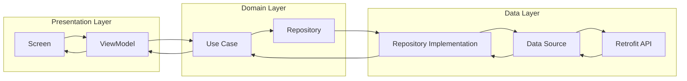
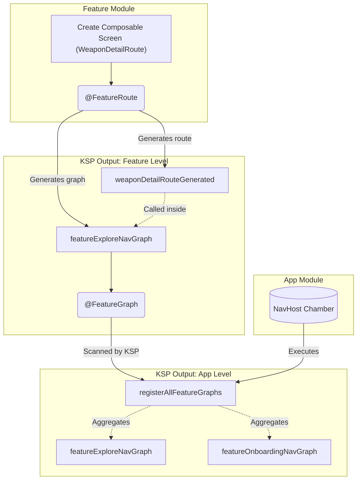

# ⚔️ Urithiru Project
**One project to rule them all.**

A modular Android application template built with Clean Architecture principles.  
Designed to be scalable, maintainable, and easy to extend — even for beginners.

It ships as **Urithiru Showcase**, a working app that shows the template off:
a live onboarding, a DummyJSON login, and four tabs (**Catalog · Shop · Explore · Profile**).
The Catalog tab demos every `Uri*` component in every state.

## ▶️ Try it
1. Build and install the dev flavor: `./gradlew :app:installDevDebug`
2. On first launch you get a 4-page onboarding. Page 3 lets you pick Light, Dark or Match system.
3. Sign in with the DummyJSON demo account (**`emilys`** / **`emilyspass`**), or continue as a guest.
4. Later launches skip onboarding. To see it again: `adb shell pm clear com.septianbeneran.urithiru.dev`

## 🗺 App structure
```
Splash ─┬─► Onboarding (first launch only) ─┬─► Login ─► Tabs
        │                                   └─► Continue as guest ─► Tabs
        └─► Tabs (onboarding already done)

Tabs (bottom bar on phones, rail on tablets):
  Catalog (home) · Shop · Explore · Profile
```
- The tabs are listed in `TopLevelDestination` in `:app`. The bar only shows on a tab's root screen.
- `navigator.navigateToTopLevel(graph)` switches tabs; each tab keeps its own history.
- `navigator.navigateToHome()` opens the first tab and clears the back stack.

## 🧰 Tech Stack
* Jetpack Compose for UI creation
* Retrofit + kotlinx-serialization for API calls
* Hilt for dependency injection
* Kotlin Coroutines and Flow for asynchronous programming
* KSP for generated navigation (`:navigation-processor`)

## 📦 Prerequisites

* Gradle 9.8.0 (via the wrapper, `./gradlew`)
* JDK 21
* Minimum Android SDK 24

## 🧱 Project Modules

The project contains the following modules:

* `:app`
* `:core`
* `:core-entity`
* `:core-navigation`
* `:core-ui`
* `:api-eldenring`
* `:api-jsonbin`
* `:api-twitch`
* `:api-dummyjson`
* `:feature-explore`
* `:feature-onboarding`
* `:feature-splash`
* `:feature-auth`
* `:feature-catalog`
* `:feature-shop`
* `:feature-profile`
* `:navigation-processor`

`buildlogic` is not a module: it's an included build that holds the convention plugins (`base-convention`, `api-convention`, `compose-convention`, `feature-convention`, `app-convention`).

For a full overview, see [`SUMMARY.md`](SUMMARY.md).

## 🏗 Architecture Flow

### 💾 Data Flow


### 🏭 Screen Route Generator


<details>
<summary><h2>⚙️ Creating New Endpoint For API Call</h2></summary>

### 1️⃣ Changing the Base URL

The Base URL is managed per environment using property files in the `productFlavorProperties` folder.

1.  Navigate to `productFlavorProperties/`.
2.  Open the file corresponding to the environment you want to change (e.g., `dev.properties`, `prod.properties`).
3.  Update the base URL you need, for example `ELDEN_RING_BASE_URL`:
    ```properties
    ELDEN_RING_BASE_URL=https://your-new-api-url.com/api/
    ```
4.  Sync the project with Gradle. Every key becomes a `BuildConfig` field automatically (e.g. `BuildConfig.ELDEN_RING_BASE_URL`).

### 2️⃣ Creating a New API Endpoint

To add a new API call, follow these steps (using the `api-eldenring` module as an example):

#### Step 0: Add the Endpoint Path
Add the path to `api-eldenring/microservice.properties`. Each key becomes a `BuildConfig` field in that module.

```properties
YOUR_DATA_V1=your/end/point
```

#### Step A: Define the Data Transfer Object (DTO)
Create your response model in `api-eldenring/src/main/java/.../data/remote/dto/`.

```kotlin
@Serializable
data class YourResponse(
    @SerialName("id") val id: String,
    @SerialName("name") val name: String
)
```

#### Step B: Add the API Interface
Create new API interface (e.g., `YourApi.kt`) and add the endpoint function.

```kotlin
interface YourApi {
    @GET
    suspend fun getYourData(
        @Url url: String
    ): Response<ApiDto<YourResponse>>
}
```

#### Step C: Update the Remote Data Source
Add the call to your `RemoteDataSource` interface and its implementation.

**Interface:**
```kotlin
suspend fun getYourData(): ApiResult<ApiDto<YourResponse>>
```

**Implementation:**
```kotlin
override suspend fun getYourData(): ApiResult<ApiDto<YourResponse>> =
    getResult { api.getYourData(YOUR_DATA_V1) }
```

#### Step D: Expose through Repository and Use Case
Finally, expose the data through the Repository and create a Use Case to be consumed by the ViewModel in the `feature` module.
</details>

<details>
<summary><h2>📱 Creating a New Screen Route</h2></summary>

To add a new screen and automatically wire it into the navigation graph, follow these steps:

#### Step A: Define the Feature Navigation Graph
First, declare the navigation graph for your feature in the `core-navigation:graph` module. This must be marked with `@Serializable`.

```kotlin
@Serializable
object FeatureExploreNavGraph
```

#### Step B: Define the Route Parameters
Next, define the specific route for your screen in the `core-navigation:routeparams` module. This also requires the `@Serializable` annotation. Use an `object` for a route without arguments, or a `data class` if you need to pass data.

```kotlin
@Serializable
object WeaponDetailRoute
```

#### Step C: Create and Annotate the Composable
In your `feature` module, create your standard Jetpack Compose UI function. Tag it with the `@FeatureRoute` annotation, linking the route parameters you just created. 

*Note: If this screen is the starting point for the feature, be sure to declare the `graph` parameter as well.*

```kotlin
@FeatureRoute(
    routeParams = WeaponDetailRoute::class,
    graph = FeatureExploreNavGraph::class // Add this ONLY if it's the start destination
)
@Composable
fun WeaponDetailScreen(navigator: Navigator) {
    // Your UI implementation here
}
```

#### Step D: Build the Project
Run a project build (or rebuild) so KSP can process the annotations. 

During the build, KSP will automatically generate:
1.  The route extension for your specific screen (e.g., `weaponDetailRouteGenerated`).
2.  The updated feature-level graph builder (e.g., `featureExploreNavGraph`) containing your new route.

#### Step E: Automatic Registration
You don't need to manually register the screen in the App module! 

The KSP processor automatically tags the generated feature graph with `@FeatureGraph`. The App module will scan for this and automatically include your new screen in the main `NavHost` via the generated `registerAllFeatureGraphs` function.

</details>

<details>
<summary><h2>🧭 Adding a New Tab</h2></summary>

A tab is a feature module whose start screen is listed in `TopLevelDestination`. Features never know about the bar.

#### Step A: Create the feature module
Copy `feature-catalog`'s `build.gradle.kts`, `.gitignore`, `*.pro` files and `src/main/AndroidManifest.xml` into `feature-x`. Then register it:

```kotlin
// settings.gradle.kts
include(":feature-x")

// app/build.gradle.kts
moduleImplementation(projects.featureX)
```

#### Step B: Add the graph and the start screen
```kotlin
// core-navigation/.../graph/FeatureXNavGraph.kt
@Serializable
object FeatureXNavGraph

// core-navigation/.../routeparams/feature_x/XRoute.kt
@Serializable
object XRoute

// feature-x/.../screen/XScreen.kt
@FeatureRoute(
    routeParams = XRoute::class,
    graph = FeatureXNavGraph::class // the tab's root screen
)
@Composable
fun XRoute(navigator: Navigator) {
    // BaseScreen(viewModel = …, topAppBarArgs = defaults(title = "X", backIcon = null)) { … }
}
```

#### Step C: Add the tab
Add two official Material Symbols icons to `core-ui/src/main/res/drawable` (`x.xml` outlined, `x_filled.xml` filled), then one line in `:app`:

```kotlin
enum class TopLevelDestination(...) {
    // ...
    X("X", R.drawable.x, R.drawable.x_filled, FeatureXNavGraph)
}
```

Build. The bar shows the new tab, switching to it keeps its own history, and Back returns to the first tab.
</details>

<details>
<summary><h2>🧩 Adding a Component to the Catalog</h2></summary>

Every shared component in `core-ui/component` should appear in the Catalog tab, so it can be tried in both themes.

1. Add an entry to the right section in `feature-catalog/.../catalog/CatalogEntries.kt`:
   ```kotlin
   CatalogEntry("my_thing", "UriMyThing", "One sentence about what it's for.")
   ```
2. Map it to a demo in `screen/demo/ComponentDemo.kt`:
   ```kotlin
   "my_thing" -> MyThingDemo()
   ```
3. Write the demo in the matching `*Demos.kt` file, one `DemoSection` per variant or state:
   ```kotlin
   @Composable
   fun MyThingDemo() {
       DemoSection("Default") { UriMyThing() }
       DemoSection("Disabled") { UriMyThing(enabled = false) }
   }
   ```
4. Open it in dark mode too (`adb shell cmd uimode night yes`). Components must use `MaterialTheme.colorScheme`, not fixed palette colors.
</details>
