# ⚔️ Urithiru
**One project to rule them all.**

A modular Android app template built with Clean Architecture, Jetpack Compose, Hilt, Retrofit and Coroutines/Flow, with screens wired into navigation by a KSP code generator.
It's meant to be easy to extend and easy to learn from: every API, screen and component follows the same small set of rules.

It ships as **Urithiru Showcase**, a working app that shows the template off: a live onboarding, a DummyJSON login, and four tabs: **Catalog · Shop · Explore · Profile**.

<p align="center">
  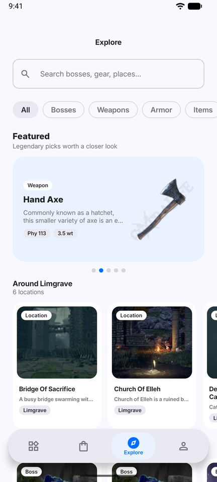
  &nbsp;
  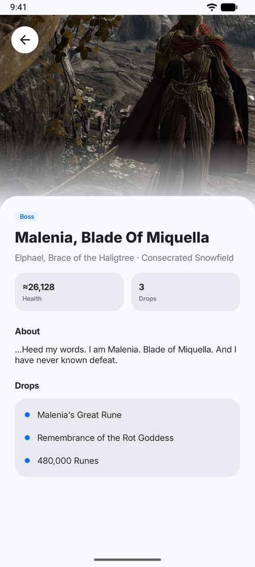
  &nbsp;
  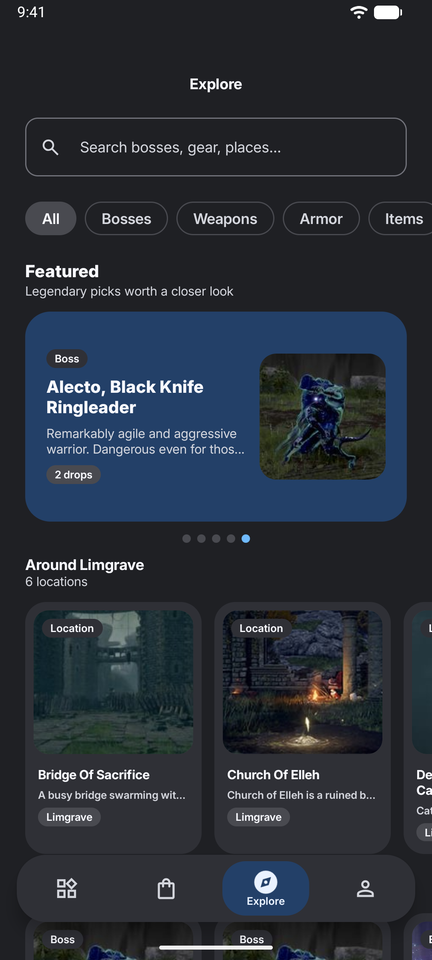
</p>

## ✨ What's inside

**🧭 Explore: an Elden Ring compendium**
- A mixed feed of bosses, weapons, armor, items, locations and NPCs from [`eldenring.fanapis.com`](https://eldenring.fanapis.com), with a card style per type.
- A Featured carousel, "Around <region>" rows, section chips and a two-column staggered grid with infinite scroll.
- Search across every section at once, grouped by type with a top result, plus "See all" per section.
- One shared detail screen: hero image, stat tiles, attack and guard bars, scaling and requirement chips, drops, effects and NPC quotes.
- Pull-to-refresh, failed sections retried as you scroll, and loading skeletons that match the real layout.

**🔐 Login and Profile** (DummyJSON)
- Sign in with access and refresh tokens. An expired token is refreshed and the request retried once, and the user is told if their session expired.
- Profile loads `auth/me` with the saved token, and has the theme picker, "Replay onboarding" and logout.

**🎨 A design system you can browse**
- The Catalog tab demos every `Uri*` component in every state, in light and dark.
- A floating, configurable bottom bar (`UriNavigationBar`) on phones that lists scroll behind, and a navigation rail on larger screens.
- Light, Dark or Match system, saved on the device and applied to the whole app, including the launch window.
- English or Bahasa Indonesia, picked in Profile (English until the user picks; the device language is never assumed). All text comes from one translation JSON.

**👋 A live onboarding**
- Text comes from JSONBin (server-driven), and every page is a working demo: real components, a simulated network error with retry, the theme picker and sign-in.

**🧪 Tests**
- Unit tests for the DTO mapping, the feed mixer, compendium search, `ExploreViewModel` and the token refresh.

## 📸 Screenshots

| Explore | Regions | Search |
|:---:|:---:|:---:|
|  | 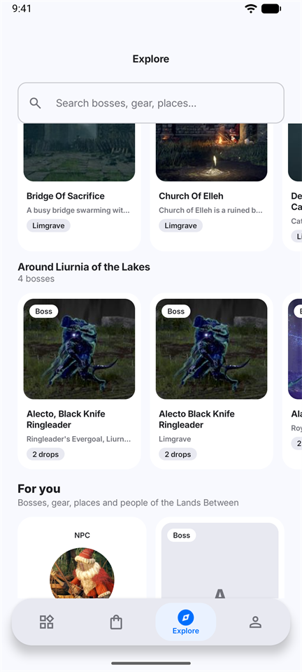 | 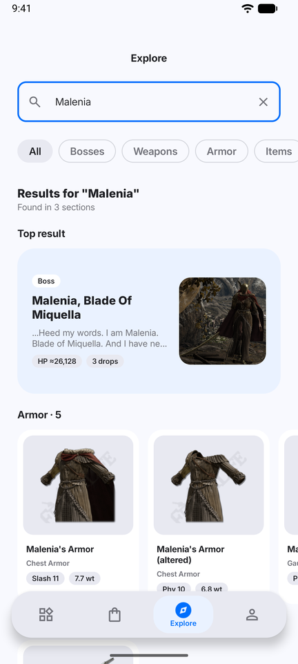 |
| **Mixed feed (dark)** | **Bosses section** | **Boss detail** |
| 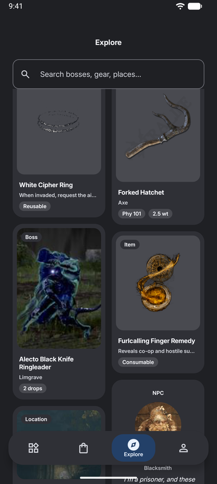 | 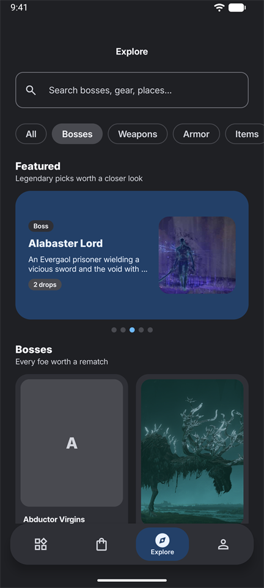 |  |
| **Weapon detail** | **Weapon stats** | **Onboarding** |
| 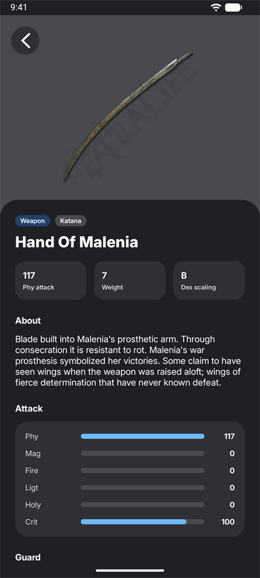 | 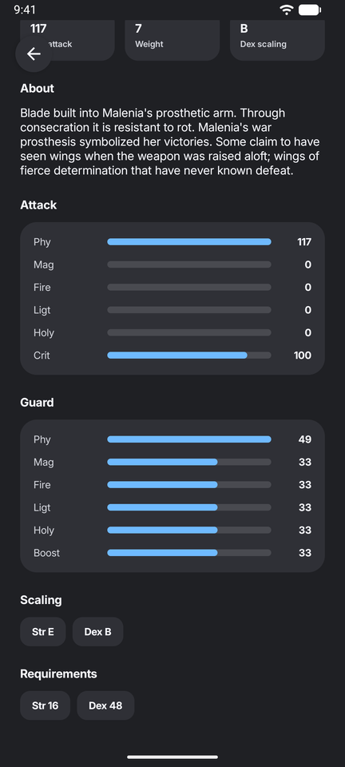 | 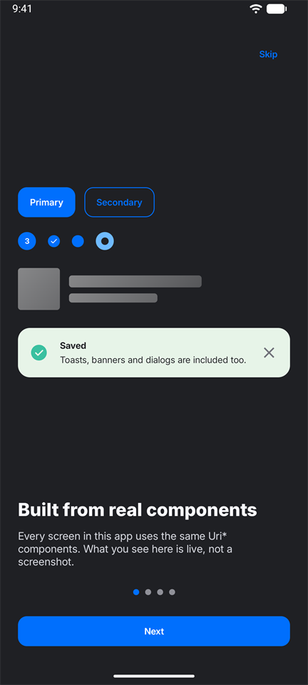 |
| **Theme picker** | **Component catalog** | **Profile** |
| 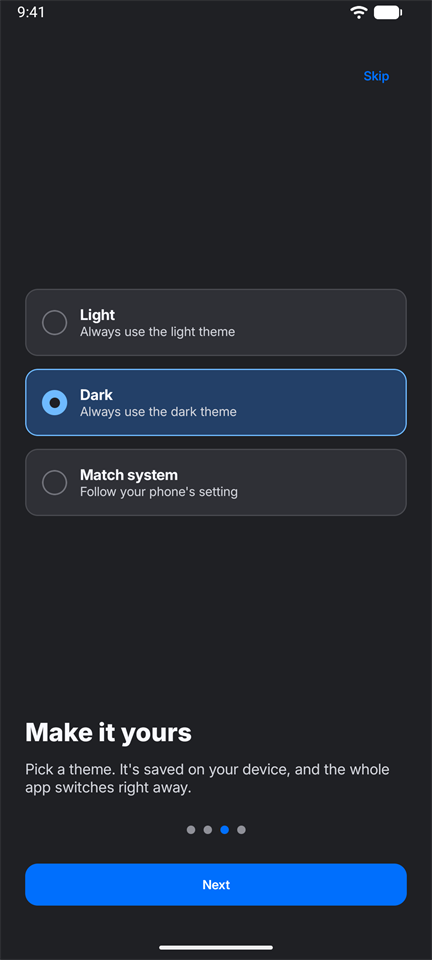 | 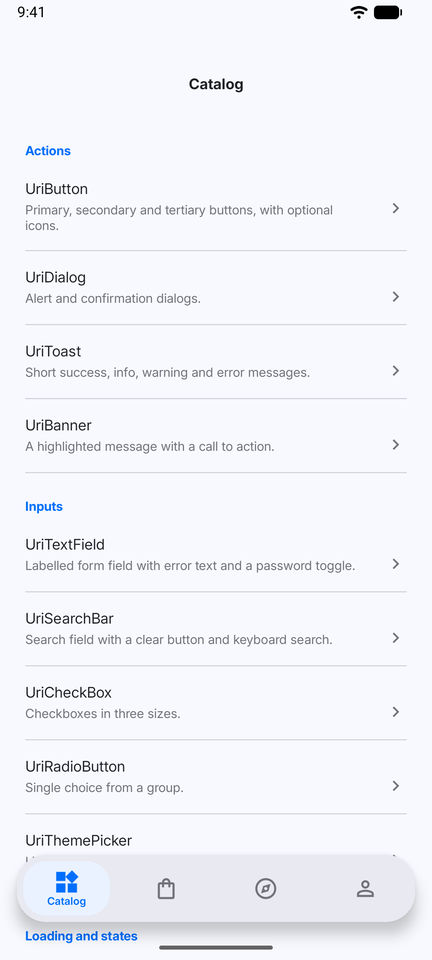 | 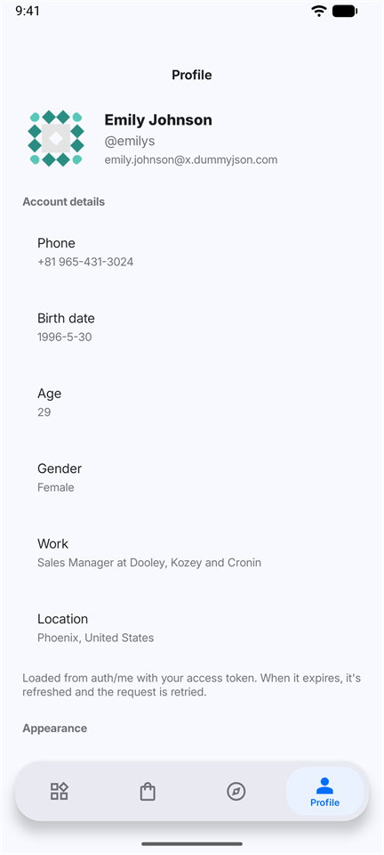 |

## ▶️ Try it
1. Build and install the dev flavor: `./gradlew :app:installDevDebug`
2. On first launch you get a 4-page onboarding. Page 3 lets you pick Light, Dark or Match system.
3. Sign in with the DummyJSON demo account (**`emilys`** / **`emilyspass`**), or continue as a guest.
4. Later launches skip onboarding. Replay it from Profile, or start completely fresh with `adb shell pm clear com.septianbeneran.urithiru.dev`.

## 🗺 App structure
```
Splash ─┬─► Onboarding (first launch only) ─┬─► Login ─► Tabs
        │                                   └─► Continue as guest ─► Tabs
        └─► Tabs (onboarding already done)

Tabs (floating bottom bar on phones, rail on tablets):
  Catalog (home) ─► Component demo
  Shop (placeholder)
  Explore (mixed feed, search) ─► Compendium detail (any type)
  Profile ─► Login · Replay onboarding
```
- The tabs are listed in `TopLevelDestination` in `:app`. The bar only shows on a tab's root screen.
- On phones the bar floats over the screen. Scrolling tabs (Explore, Catalog, Profile) run behind it; other screens are padded to stay clear of it.
- `navigator.navigateToTopLevel(graph)` switches tabs; each tab keeps its own history.
- `navigator.navigateToHome()` opens the first tab and clears the back stack.

## 🧰 Tech stack
- **UI:** Jetpack Compose, Material 3, Material 3 adaptive navigation suite, Coil 3 for images
- **Architecture:** Clean Architecture (data, domain and presentation per module), MVVM with a single `onAction` per screen
- **DI:** Hilt
- **Networking:** Retrofit + OkHttp + kotlinx-serialization (one shared `Json`), typed `AppError`
- **Async:** Kotlin Coroutines and Flow
- **Storage:** Preferences DataStore
- **Navigation:** type-safe Navigation Compose, with routes generated by KSP (`:navigation-processor`)
- **Tests:** JUnit 4 and `kotlinx-coroutines-test`

## 📦 Prerequisites
- JDK 21
- Gradle 9.8.2 (through the wrapper, `./gradlew`)
- Android SDK 37 to compile; the app runs on Android 7.0 (API 24) and up

## 🧱 Modules

| Module | What it holds |
|---|---|
| `:app` | `MainActivity`, the `NavHost` (`NavHostChamber`), the tabs and app-wide Hilt bindings |
| `:core` | Base data source and repository, `ApiResult`/`AppError`/`BaseState`, Retrofit and OkHttp setup, DataStore, settings, generic extensions |
| `:core-entity` | Domain models (`CompendiumEntry` and its types, `AuthSession`, `User`, …) |
| `:core-navigation` | Route and graph classes shared by features, `Navigator`, the `@FeatureRoute` annotation |
| `:core-ui` | `BaseScreen`, `BaseViewModel`, the theme, the `Uri*` components and Compose extensions |
| `:api-eldenring` | The Elden Ring compendium: bosses, weapons, armor, items, locations, NPCs |
| `:api-dummyjson` | Login, token refresh, `auth/me` and the saved session |
| `:api-jsonbin` | Server-driven onboarding text |
| `:api-twitch` | A Twitch OAuth `client_credentials` token flow (kept as an example) |
| `:feature-splash` · `:feature-onboarding` · `:feature-auth` | First-launch flow and login |
| `:feature-catalog` · `:feature-shop` · `:feature-explore` · `:feature-profile` | The four tabs |
| `:navigation-processor` | The KSP processor that generates the feature graphs |

`buildlogic` is not a module: it's an included build with the convention plugins (`base-convention`, `api-convention`, `compose-convention`, `feature-convention`, `app-convention`).

Dependencies only point down: `app → feature-* → api-* → core, core-entity`. Features never depend on each other; they navigate through the routes in `:core-navigation`.

More detail: [`SUMMARY.md`](SUMMARY.md) (full overview), [`FOR READING.md`](FOR%20READING.md) (roadmap and recipes) and [`CLAUDE.md`](CLAUDE.md) (conventions).

## 🏗 Architecture

### 💾 Data flow
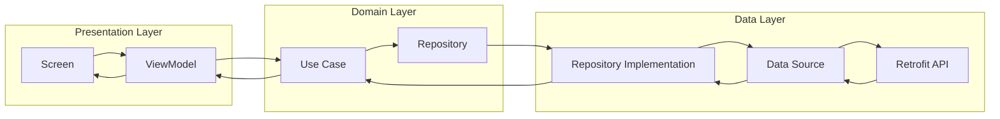

Every network call returns `Flow<ApiResult<T>>` (`Loading`, then `Success` or `Error`). Errors are mapped once, in `BaseDataSource.getResult`, to a typed `AppError`, and `AppError.toMessage()` turns them into a translatable message.

### 🏭 Screen route generator
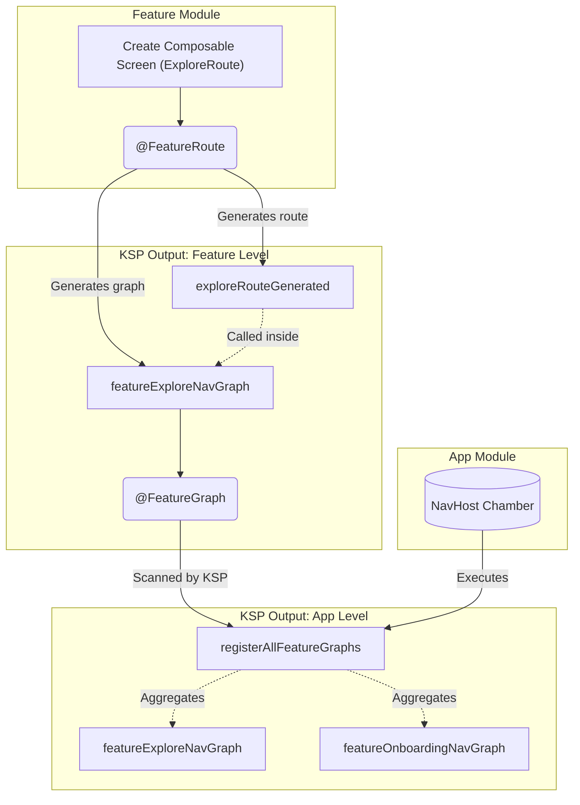

## 🧪 Running the tests
```bash
./gradlew testDevDebugUnitTest                        # every module
./gradlew :feature-explore:testDevDebugUnitTest       # one module
```

<details>
<summary><h2>⚙️ Adding a new API endpoint</h2></summary>

The example adds DummyJSON's product list (`GET products`) to `api-dummyjson`. Every API module has the same layers:

```
data/remote/api/        Retrofit interface
data/remote/dto/        Response DTOs + mapToEntity()
data/remote/service/    RemoteDataSource + Impl (extends BaseDataSource)
repository/             Repository + Impl (extends BaseRepository)
domain/get|load|post|clear/   One use case per action: interface + Impl
di/                     Hilt modules
```

### 1. Base URL and endpoint path
- **Base URL:** one per backend and flavor, in `productFlavorProperties/<flavor>.properties` (e.g. `DUMMY_JSON_BASE_URL=https://dummyjson.com/`). It becomes a `BuildConfig` field. A new backend also needs its own `Retrofit` with a qualifier (e.g. `@DummyJsonNetwork`) in `core/di/NetworkModule.kt`.
- **Endpoint path:** write it as a string where the data source calls the API (step 5), relative to the base URL with no leading `/`, e.g. `"products"` or `"products/$id"`.

### 2. The entity (`:core-entity`)
```kotlin
data class Product(
    val id: Int,
    val title: String,
    val price: Double,
    val thumbnail: String?
)
```

### 3. The DTO (`data/remote/dto/`)
kotlinx-serialization only (never Gson): mark it `@Serializable`, rename fields with `@SerialName`, and map it to the entity.
```kotlin
@Serializable
data class ProductListResponse(
    @SerialName("products") val products: List<ProductResponse>,
    @SerialName("total") val total: Int
) {
    fun mapToEntity() = products.map { it.mapToEntity() }
}

@Serializable
data class ProductResponse(
    @SerialName("id") val id: Int,
    @SerialName("title") val title: String,
    @SerialName("price") val price: Double,
    @SerialName("thumbnail") val thumbnail: String? = null
) {
    fun mapToEntity() = Product(id = id, title = title.trim(), price = price, thumbnail = thumbnail)
}
```
`String?.cleaned()` (`:core`) trims text and turns blanks into null, if the API sends untidy strings.

### 4. The Retrofit interface (`data/remote/api/`)
Use `@Url`; the data source passes the path in.
```kotlin
interface ProductApi {
    @GET
    suspend fun getProducts(
        @Url url: String,
        @Query("limit") limit: Int,
        @Query("skip") skip: Int
    ): Response<ProductListResponse>
}
```
APIs that need the user's token go in a separate interface built with the authenticated client (see `UserApi`: `AuthInterceptor` adds the token, `TokenAuthenticator` refreshes it on a 401).

### 5. The data source (`data/remote/service/`)
Wrap every call in `getResult { }`, which turns failures into an `AppError`. Never invent error codes yourself.
```kotlin
interface ProductRemoteDataSource {
    suspend fun getProducts(limit: Int, skip: Int): ApiResult<ProductListResponse>
}

class ProductRemoteDataSourceImpl @Inject constructor(
    private val api: ProductApi
) : ProductRemoteDataSource, BaseDataSource() {
    override suspend fun getProducts(limit: Int, skip: Int) =
        getResult { api.getProducts("products", limit, skip) }
}
```

### 6. The repository (`repository/`)
```kotlin
interface ProductRepository {
    fun getProducts(limit: Int, skip: Int): Flow<ApiResult<List<Product>>>
}

class ProductRepositoryImpl @Inject constructor(
    private val remote: ProductRemoteDataSource,
    private val dispatcher: CoroutineDispatcherProvider,
    @ApplicationScope applicationScope: CoroutineScope
) : BaseRepository(applicationScope), ProductRepository {
    override fun getProducts(limit: Int, skip: Int) = resultFlow(
        networkCall = { remote.getProducts(limit, skip) },
        dispatcher = dispatcher
    ).mapToEntity(
        transform = { requireNotNull(it).mapToEntity() }
    )
}
```

### 7. The use case (`domain/get/`)
One use case per action, as an interface plus an `Impl` with `operator fun invoke`.
```kotlin
interface GetProductsUseCase {
    operator fun invoke(limit: Int, skip: Int): Flow<ApiResult<List<Product>>>
}

class GetProductsUseCaseImpl @Inject constructor(
    private val repository: ProductRepository
) : GetProductsUseCase {
    override fun invoke(limit: Int, skip: Int) = repository.getProducts(limit, skip)
}
```

### 8. Hilt (`di/`)
Bind every `Impl` with `@Binds`. Only the Retrofit API is built with `@Provides`. Data sources and repositories are `@Singleton`; use cases are unscoped.
```kotlin
// DummyJsonModule
@Binds @Singleton
abstract fun bindProductRemoteDataSource(impl: ProductRemoteDataSourceImpl): ProductRemoteDataSource

@Binds @Singleton
abstract fun bindProductRepository(impl: ProductRepositoryImpl): ProductRepository

companion object {
    @Provides @Singleton
    fun provideProductApi(@DummyJsonNetwork retrofit: Retrofit): ProductApi =
        retrofit.create(ProductApi::class.java)
}

// UseCaseModule
@Binds
abstract fun bindGetProductsUseCase(impl: GetProductsUseCaseImpl): GetProductsUseCase
```

### 9. Use it from a ViewModel
```kotlin
collectApi(
    flow = getProductsUseCase(limit = 20, skip = 0),
    key = "products", // a newer call with the same key cancels the older one (search, refresh, paging)
    onLoading = { _uiState.update { it.copy(productsState = StateLoading) } },
    onError = { error -> _uiState.update { it.copy(productsState = StateFailed(error)) } },
    onSuccess = { products -> _uiState.update { it.copy(productsState = StateSuccess(products.orEmpty())) } }
)
```

### Adding a section to the Elden Ring compendium
`api-eldenring` uses one shared stack for every section, so a new section (e.g. talismans) is smaller:
1. Add `Talismans` to `CompendiumKind`.
2. Add a `Talisman` entity that implements the sealed `CompendiumEntry`.
3. Add a `TalismanResponse` DTO that implements `CompendiumResponse.mapToEntry()`.
4. Add `getTalismanList` / `getTalismanDetail` to `CompendiumApi`, and a branch for each in `CompendiumRemoteDataSourceImpl` with the paths `"talismans"` and `"talismans/$id"`.

Build: every `when` over `CompendiumKind` or `CompendiumEntry` that doesn't handle the new type fails to compile, which points you to each screen that needs a card style or a label.
</details>

<details>
<summary><h2>📱 Adding a new screen</h2></summary>

The example adds a detail screen with arguments, like Explore's `CompendiumDetailRoute`.

### 1. The route (`:core-navigation`)
Add a `@Serializable` route in `core-navigation/.../routeparams/<feature_x>/`. Use an `object` for a screen without arguments, or a `data class` for one with arguments.
```kotlin
@Serializable
data class ProductDetailRoute(val id: Int)
```
A new feature also needs a graph object in `core-navigation/.../graph/` (`@Serializable object FeatureShopNavGraph`).

### 2. State, actions and one-shot events (`screen/stateaction/ProductDetailStateAction.kt`)
```kotlin
data class ProductDetailUiState(
    val productState: BaseState<Product> = BaseState.StateInitial
)

sealed interface ProductDetailAction {
    data object Retry : ProductDetailAction
}

sealed interface ProductDetailNonce : BaseNonce
```
`XAction` is what the user does; `XNonce` is a one-shot event for the screen, usually navigation.

### 3. The ViewModel (`viewmodel/`)
```kotlin
@HiltViewModel
class ProductDetailViewModel @Inject constructor(
    private val getProductUseCase: GetProductUseCase,
    savedStateHandle: SavedStateHandle
) : BaseViewModel() {

    private val _uiState = MutableStateFlow(ProductDetailUiState())
    val uiState = _uiState.asStateFlow()

    private val route = savedStateHandle.toRoute<ProductDetailRoute>()

    init {
        load()
    }

    fun onAction(action: ProductDetailAction) {
        when (action) {
            ProductDetailAction.Retry -> load()
        }
    }

    private fun load() {
        collectApi(
            flow = getProductUseCase(route.id),
            onLoading = { _uiState.update { it.copy(productState = StateLoading) } },
            onError = { error -> _uiState.update { it.copy(productState = StateFailed(error)) } },
            onSuccess = { product -> _uiState.update { it.copy(productState = StateSuccess(product)) } }
        )
    }
}
```
Use `collectApi(...)` for network flows, `collectLocalData(...)` for saved data, and `sendNonce(...)` for events.

### 4. The screen
Annotate the composable with `@FeatureRoute`. It must take `(navigator: Navigator)`. Wrap the content in `BaseScreen` and show failures with `UriErrorState`.
```kotlin
@FeatureRoute(routeParams = ProductDetailRoute::class)
@Composable
fun ProductDetailRoute(navigator: Navigator) {
    val viewModel: ProductDetailViewModel = hiltViewModel()
    val uiState by viewModel.uiState.collectAsStateWithLifecycle()

    BaseScreen(
        viewModel = viewModel,
        topAppBarArgs = defaults(title = "Product")
    ) {
        when (val state = uiState.productState) {
            is StateSuccess -> state.value?.let { ProductDetailContent(it) }
            is StateFailed -> UriErrorState(
                error = state.failed,
                onRetry = { viewModel.onAction(ProductDetailAction.Retry) }
            )
            else -> ProductDetailSkeleton()
        }
    }

    NonceObserver(nonce = viewModel.nonce) { nonce ->
        // handle ProductDetailNonce events, e.g. navigation
    }
}
```
- **Start screen of a feature:** set `graph` too, e.g. `@FeatureRoute(routeParams = ProductListRoute::class, graph = FeatureShopNavGraph::class)`. Exactly one screen per feature does this.
- **UI rules:** reuse `core-ui` components and `UrithiruTheme` tokens, take colors from `MaterialTheme.colorScheme` (never the raw palette), and show empty results with `UriEmptyState`.
- **Text:** never hardcode UI text. Add a resource whose value is its camelCase key (`<string name="explore_featured">exploreFeatured</string>`) to the module's `strings.xml` (`:core-ui` as `common_…` if several modules use it), add the key to every language in `core/src/main/assets/localization/translations.json`, and read it with `localizedString(R.string.explore_featured)`.

### 5. Open it from another screen
The other screen's ViewModel sends a nonce, and its screen navigates:
```kotlin
// ViewModel
sendNonce(ProductListNonce.NavigateToDetail(product.id))

// Screen
NonceObserver(nonce = viewModel.nonce) { nonce ->
    when (nonce) {
        is ProductListNonce.NavigateToDetail -> navigator.navigate(ProductDetailRoute(nonce.id))
    }
}
```

### 6. Build
KSP generates the route (`productDetailRouteGenerated`), adds it to the feature graph, and `registerAllFeatureGraphs()` puts it in the `NavHost`. Never register screens by hand. If the generated code looks stale after changing `@FeatureRoute`, run `./gradlew clean assembleDevDebug`.
</details>

<details>
<summary><h2>🧭 Adding a new tab</h2></summary>

A tab is a feature module whose start screen is listed in `TopLevelDestination`. Features never know about the bar.

#### Step A: Create the feature module
Copy `feature-catalog`'s `build.gradle.kts`, `.gitignore`, `*.pro` files and `src/main/AndroidManifest.xml` into `feature-x`. Then register it:

```kotlin
// settings.gradle.kts
include(":feature-x")

// app/build.gradle.kts
moduleImplementation(projects.featureX)
```

#### Step B: Add the graph and the start screen
```kotlin
// core-navigation/.../graph/FeatureXNavGraph.kt
@Serializable
object FeatureXNavGraph

// core-navigation/.../routeparams/feature_x/XRoute.kt
@Serializable
object XRoute

// feature-x/.../screen/XScreen.kt
@FeatureRoute(
    routeParams = XRoute::class,
    graph = FeatureXNavGraph::class // the tab's root screen
)
@Composable
fun XRoute(navigator: Navigator) {
    // BaseScreen(viewModel = …, topAppBarArgs = defaults(title = "X", backIcon = null)) { … }
}
```

#### Step C: Add the tab
Add two official Material Symbols icons to `core-ui/src/main/res/drawable` (`x.xml` outlined, `x_filled.xml` filled), then one line in `:app`:

```kotlin
enum class TopLevelDestination(...) {
    // ...
    X("X", R.drawable.x, R.drawable.x_filled, FeatureXNavGraph)
}
```

Build. The bar shows the new tab, switching to it keeps its own history, and Back returns to the first tab. To restyle the bar itself, change `NavigationBarStyle` in `NavHostChamber.kt`.

#### Step D (optional): Scroll behind the floating bar
By default `BaseScreen` keeps the content above the floating bar. If the tab's root screen scrolls, let it run behind the bar instead, and give the list enough bottom padding for its last item to clear it:

```kotlin
BaseScreen(viewModel = viewModel, drawBehindBottomOverlay = true, ...) {
    LazyColumn(
        contentPadding = PaddingValues(bottom = 16.dp + LocalScreenBottomPadding.current)
    ) { ... }
}
```
</details>

<details>
<summary><h2>🧩 Adding a component to the Catalog</h2></summary>

Every shared component in `core-ui/component` should appear in the Catalog tab, so it can be tried in both themes.

1. Add an entry to the right section in `feature-catalog/.../catalog/CatalogEntries.kt`:
   ```kotlin
   CatalogEntry("my_thing", "UriMyThing", "One sentence about what it's for.")
   ```
2. Map it to a demo in `screen/demo/ComponentDemo.kt`:
   ```kotlin
   "my_thing" -> MyThingDemo()
   ```
3. Write the demo in the matching `*Demos.kt` file, one `DemoSection` per variant or state:
   ```kotlin
   @Composable
   fun MyThingDemo() {
       DemoSection("Default") { UriMyThing() }
       DemoSection("Disabled") { UriMyThing(enabled = false) }
   }
   ```
4. Open it in dark mode too (pick Dark in Profile). Components must use `MaterialTheme.colorScheme`, not fixed palette colors.

Shared extension functions go in one file per type: `core/util/extension/` for Kotlin and Android types (`StringExtensions.kt`, …) and `core-ui/util/extension/` for Compose types (`ModifierExtensions.kt`, …).
</details>
